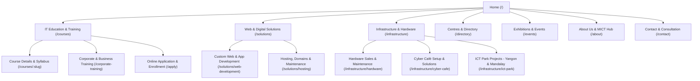
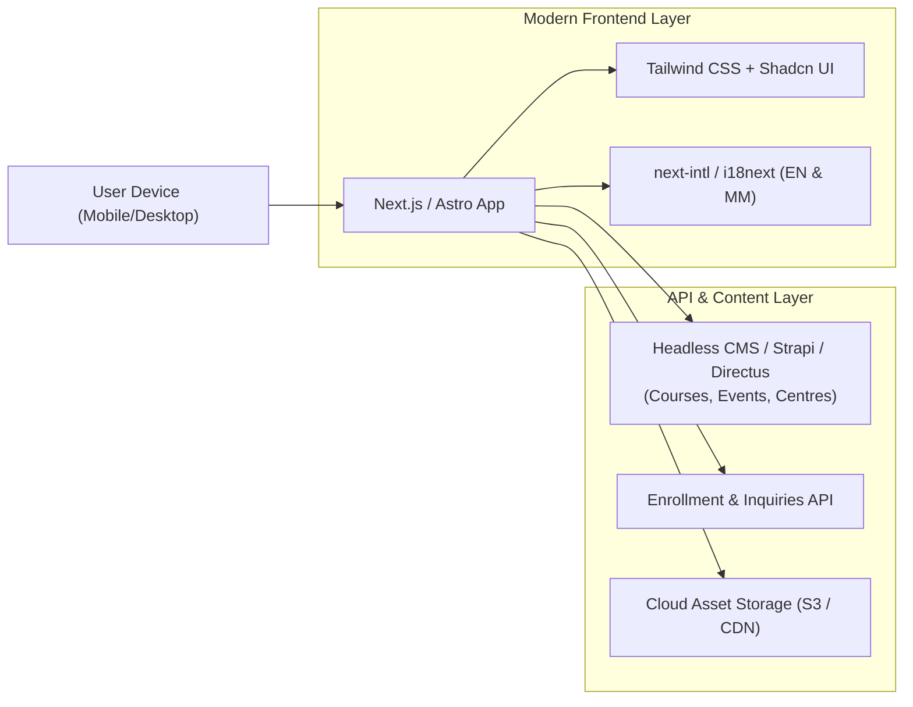

# Design Specification: Myanmar Computer (`myanmarcomputer.com`)

**Document Version:** 1.0.0  
**Source Baseline:** `myanmar_computer_overview.md`  
**Target Platform:** Responsive Web Application & Corporate Portal  
**Target Audience:** Students & Career Changers, Enterprise & SME Clients, ICT Event Attendees, Academic & Government Partners  

---

## 1. Executive Summary & Brand Identity

### 1.1 Brand Purpose & Vision
Myanmar Computer (Myanmar Computer Co., Ltd.) is a pioneer IT services and educational institution headquartered at MICT Park, Hlaing Township, Yangon. Its mission is captured in its dual core taglines:
* **"Technology for Tomorrow"** — Forward-looking technological advancement and digital infrastructure.
* **"Empowering Myanmar Through Technology"** — Cultivating domestic IT talent, supporting enterprise digital transformation, and driving nationwide connectivity.

### 1.2 Strategic Goals of the Web Presence
1. **Lead Generation & Student Enrollment:** Drive enrollment for IT academy courses (from basic computer literacy to full-stack web development and networking).
2. **B2B Service Showcase:** Present enterprise offerings (custom web development, domain & cloud hosting, cyber café solutions, hardware maintenance, and ICT Park ventures).
3. **Information Hub & Community Directory:** Serve as an authoritative directory for affiliated computer centres, technology events, exhibitions, and ICT Park initiatives (MICT Park Yangon & Mandalay ICT Park).
4. **Bilingual Accessibility:** Ensure seamless dual-language UX (English and Myanmar Unicode) accessible across diverse desktop and mobile devices nationwide.

---

## 2. Information Architecture (IA) & Sitemap

### 2.1 Global Architecture



### 2.2 Navigation Taxonomy

| Top-Level Menu | Sub-Items / Dropdown Sections | Primary CTA / Action |
| :--- | :--- | :--- |
| **Courses & Academy** | • Basic & Office Productivity<br>• Web Design & Development<br>• Networking & System Administration<br>• Corporate Workforce Training | "Browse Courses" / "Enroll Now" |
| **Web & Cloud Solutions** | • Custom Web Design<br>• Web Application Development<br>• Domain Registration & Hosting Packages<br>• Website Maintenance & SLA | "Request a Quote" |
| **IT Infrastructure** | • Hardware Sales & Fleet Supply<br>• Enterprise IT AMC (Annual Maintenance)<br>• Cyber Café Turnkey Solutions<br>• MICT Park Collaborations | "Consult a Specialist" |
| **Directory & Network** | • Affiliated Computer Centres<br>• Branch & Training Campus Locations<br>• Regional Partner Network | "Locate a Centre" |
| **Events & News** | • Tech Exhibitions & Seminars<br>• Student Showcases & Hackathons<br>• Industry News & Announcements | "Register for Event" |
| **About Us** | • Company History & Vision<br>• Leadership & Instructors<br>• Career Opportunities<br>• MICT Park Yangon HQ | "Get in Touch" |

---

## 3. Design System & Visual Guidelines

### 3.1 Design Principles
* **Rooted Modernity:** Pair dependable evergreen tones with warm parchment, lacquer-red action accents, and restrained saffron details. Use connectivity-inspired linework rather than generic neon effects.
* **High Legibility for Bilingual Text:** Explicit hierarchy tailored to accommodate Myanmar script metrics (line heights, diacritic accents) alongside Latin typography.
* **Performance-First & Data-Conscious:** Optimized for low-bandwidth scenarios common across local mobile connections, with lazy loading, SVG vector iconography, and lightweight CSS.
* **Warmth & Accessibility:** High contrast ratios (WCAG 2.1 AA compliant) ensuring comfort for students of all age groups and skill levels.

### 3.2 Color System

```
Primary: Evergreen (#17463D)          Secondary: River Teal (#236358)
Action: Lacquer Red (#B84F36)         Highlight: Muted Saffron (#D8A447)
Growth: Forest Green (#2F775C)        Neutral Dark: Deep Evergreen (#10241F)
Neutral Light: Parchment (#F7F4EC)    Surface: Warm White (#FFFCF6)
```

| Token Name | Hex Code | Role & Usage |
| :--- | :--- | :--- |
| `--color-primary-navy` | `#17463D` | Evergreen brand anchor for headings, navigation marks, and primary surfaces. |
| `--color-primary-blue` | `#236358` | River-teal secondary surface for active states, icons, and gradients. |
| `--color-accent-cyan` | `#B84F36` | Lacquer-red calls to action, links, and key interactive states. |
| `--color-accent-amber` | `#D8A447` | Muted saffron details for highlights, badges, and enrollment notices. |
| `--color-success-green` | `#2F775C` | Verification marks, completion indicators, and availability tags. |
| `--color-slate-900` | `#1A2E29` | Core body typography on light backgrounds. |
| `--color-slate-600` | `#555E55` | Secondary text, subtitles, metadata, and breadcrumbs. |
| `--color-slate-100` | `#EFEADF` | Alternate section background, card borders, and dividers. |
| `--color-background` | `#F7F4EC` | Warm parchment page canvas; use warm white for cards and elevated surfaces. |

### 3.3 Typography Hierarchy

#### Font Families
* **English / International Font:** `Inter`, `-apple-system`, `BlinkMacSystemFont`, `Segoe UI`, `Roboto`, sans-serif.
* **Myanmar Unicode Font:** `Pyidaungsu`, `Padauk`, `Noto Sans Myanmar`, sans-serif.
* **Monospace / Code Font:** `JetBrains Mono`, `Fira Code`, monospace.

#### Type Scale & Sizing

| Level | Size (rem / px) | Weight | Line Height | Usage |
| :--- | :--- | :--- | :--- | :--- |
| **Display 1** | `3.0rem` (48px) | 800 (Bold) | 1.15 | Hero landing headline |
| **Heading 1** | `2.25rem` (36px) | 700 (Bold) | 1.25 | Major page titles |
| **Heading 2** | `1.75rem` (28px) | 600 (SemiBold) | 1.35 | Section headers |
| **Heading 3** | `1.25rem` (20px) | 600 (SemiBold) | 1.40 | Card titles, module headers |
| **Body Large** | `1.125rem` (18px) | 400 (Regular) | 1.60 | Lead paragraphs, hero intro |
| **Body Regular** | `1.0rem` (16px) | 400 (Regular) | 1.65 (1.8 for MM) | Main reading text, course specs |
| **Caption / Small** | `0.875rem` (14px) | 500 (Medium) | 1.50 | Badges, timestamps, footer links |

> [!IMPORTANT]
> **Myanmar Typography Note:** For Burmese text rendering, the CSS `line-height` should default to `1.8` to prevent vertical clipping of upper and lower diacritics (tone marks and vowel signs).

### 3.4 Spacing & Grid System
* **Base Unit:** 8px spacing scale (`4px`, `8px`, `12px`, `16px`, `24px`, `32px`, `48px`, `64px`, `96px`).
* **Container Widths:**
  * Desktop Max: `1280px` (standard container).
  * Ultra-Wide: `1440px` (edge-to-edge layout limit).
  * Tablet: `768px` to `1024px` (adaptive fluid padding).
  * Mobile: `360px` to `480px` (`16px` lateral gutter padding).
* **Corner Radius:**
  * Small (Buttons, Badges): `6px` / `0.375rem`
  * Medium (Cards, Modals): `12px` / `0.75rem`
  * Large (Hero Banners, Feature Containers): `20px` / `1.25rem`

---

## 4. Key Page Layouts & UX Wireframes

### 4.1 Global Header & Navigation Bar
* **Top Utility Strip:**
  * Location Indicator: "ICT Park Road, Hlaing Township, Yangon"
  * Quick Contact: Phone & Email
  * Language Switcher: `[EN | မြန်မာ]` toggle button
* **Primary Nav Bar (Sticky):**
  * Brand Logo: Myanmar Computer emblem + logotype with tagline
  * Navigation Links: Courses | Solutions | Infrastructure | Directory | Events | About
  * Action Buttons:
    * Secondary Outline Button: "Check Schedule"
    * Primary Filled Button: "Apply Now" (Lacquer-red fill)

### 4.2 Homepage (`/`) Wireframe Structure

```
+--------------------------------------------------------------------------+
|  [MICT Park, Yangon]    contact@myanmarcomputer.com     [Language: EN/MM]|
+--------------------------------------------------------------------------+
|  [LOGO] Myanmar Computer   Courses  Solutions  Infra  Events   [Enroll]   |
+--------------------------------------------------------------------------+
|                                                                          |
|  HERO SECTION                                                            |
|  "Empowering Myanmar Through Technology"                                 |
|  Subtext: Leading IT Academy, Enterprise Web Solutions & Infrastructure   |
|  [Explore Courses] (Primary)      [Enterprise IT Solutions] (Secondary)  |
|                                                                          |
|  Key Stats Banner:                                                       |
|  [ 25+ Years Experience ] [ 15,000+ Students ] [ 500+ Corporate Clients ]|
+--------------------------------------------------------------------------+
|  THREE PILLARS OF SERVICE                                                |
|  +--------------------+  +--------------------+  +--------------------+  |
|  | IT Education       |  | Web & Digital      |  | Tech Infrastructure|  |
|  | - Practical Labs   |  | - Custom Web Dev   |  | - Hardware Supply  |  |
|  | - Certifications   |  | - Domain & Cloud   |  | - Cyber Cafe Setup |  |
|  | - Corporate Upskill|  | - SLA Maintenance  |  | - MICT Park Collab |  |
|  +--------------------+  +--------------------+  +--------------------+  |
+--------------------------------------------------------------------------+
|  FEATURED COURSES & UPCOMING BATCHES                                      |
|  Filter: [All] [Basic Literacy] [Web Dev] [Networking] [Corporate]       |
|  +-------------------+  +-------------------+  +-------------------+     |
|  | Web Dev Mastery   |  | Network Admin     |  | Office Suite Pro  |     |
|  | 12 Weeks | Lab    |  | 8 Weeks | Cisco   |  | 4 Weeks | Weekend |     |
|  | Next: Nov 15      |  | Next: Nov 20      |  | Next: Dec 01      |     |
|  | [View Syllabus]   |  | [View Syllabus]   |  | [View Syllabus]   |     |
|  +-------------------+  +-------------------+  +-------------------+     |
+--------------------------------------------------------------------------+
|  AFFILIATED COMPUTER CENTRES & MICT PARK COLLABORATION                   |
|  Interactive Map & Directory Preview (Yangon HQ & Mandalay ICT Hub)      |
+--------------------------------------------------------------------------+
|  UPCOMING TECH EXHIBITIONS & EVENTS                                      |
|  Event Cards with Dates, Venue, Speaker line-up, Registration CTA        |
+--------------------------------------------------------------------------+
|  FOOTER: Sitemap, Accreditations, Social Links, Address, Copyright 2026  |
+--------------------------------------------------------------------------+
```

### 4.3 IT Education & Training Portal (`/courses`)
* **Filtering & Search Bar:**
  * Search by course title or keyword.
  * Filter pills: Level (Beginner / Intermediate / Advanced), Schedule (Weekday / Weekend / Evening), Format (On-campus Lab / Hybrid).
* **Course Card Component:**
  * Thumbnail image with live badge ("Enrollment Open" / "Filling Fast").
  * Title, duration in weeks/hours, certified instructor name.
  * Skills learned tags (e.g. `HTML5`, `React`, `Python`, `Cisco CCNA`).
  * Price / Tuition fee and next batch start date.
  * Direct CTAs: "Download Syllabus (PDF)" & "Apply Now".
* **Corporate Training Tab:**
  * Custom on-site corporate training curriculum builder.
  * Request form for enterprise employee upskilling.

### 4.4 Web Development & Digital Solutions (`/solutions`)
* **Service Tiers Presentation:**
  * **Custom Web Design & Apps:** UI/UX prototype, responsive portal development, CMS implementation, API integrations.
  * **Hosting & Domain Packages:** Localized high-speed hosting, SSL certificates, `.com.mm` / `.mm` / `.com` domain registration, automated backups.
  * **Maintenance & Support (SLA):** Monthly security audits, uptime monitoring, bug patching.
* **Interactive Cost Estimator / RFP Form:**
  * Step-by-step project scope selector (Type, Pages, Features, Timeline).

### 4.5 Technology Infrastructure & Services (`/infrastructure`)
* **Hardware & Equipment Sales:**
  * Desktop rigs for school/office labs, servers, enterprise routers, uninterruptible power supplies (UPS).
* **Cyber Café Turnkey Setup:**
  * Network cabling, billing/management software integration, workstation configuration, internet routing optimization.
* **ICT Park Collaboration Section:**
  * Highlighting partnerships with MICT Park (Hlaing, Yangon) and Mandalay ICT Park developments.
  * Fostering Myanmar's digital ecosystem with co-working spaces and innovation seminars.

### 4.6 Directory of Affiliated Computer Centres (`/directory`)
* **Interactive Region Switcher:**
  * Division/State selector (Yangon, Mandalay, Naypyidaw, Bago, etc.).
* **Centre Cards:**
  * Centre Name & Affiliation badge.
  * Physical address, Google Maps link, contact phone numbers, and operational hours.
  * Available facilities (e.g. "Air-conditioned Lab", "Fiber Internet", "Testing Centre").

### 4.7 Exhibitions & Events Hub (`/events`)
* **Upcoming Events Calendar:**
  * National ICT fairs, annual student project showcases, career expos, and developer workshops.
* **Event Detail & Registration Modal:**
  * Speaker bios, agenda timetable, venue directions at ICT Park, QR-code ticket generator.

---

## 5. Bilingual & Localization Architecture

### 5.1 Language Switcher & Storage
* Dual language keys: `en` (English) and `my` (Myanmar Unicode).
* Persisted in `localStorage` with fallback to browser header `navigator.language`.
* Dynamic font-family switching based on the active language class (`lang-en` vs `lang-my`).

### 5.2 Content Localization Matrix

| UI Component | English Label | Myanmar Unicode Label |
| :--- | :--- | :--- |
| **Site Tagline 1** | Technology for Tomorrow | မနက်ဖြန်အတွက် နည်းပညာ |
| **Site Tagline 2** | Empowering Myanmar Through Technology | နည်းပညာဖြင့် မြန်မာပြည်ကို စွမ်းဆောင်ရည်မြှင့်တင်ခြင်း |
| **Primary CTA** | Enroll Now | ယခုပဲ လျှောက်ထားပါ |
| **Secondary CTA** | Explore Courses | သင်တန်းများ ကြည့်ရှုရန် |
| **Corporate CTA** | Business Solutions | လုပ်ငန်းသုံး အိုင်တီ ဝန်ဆောင်မှုများ |
| **Contact Address** | No. 123, ICT Park Road, Hlaing Township, Yangon | အမှတ် (၁၂၃)၊ အိုင်စီတီ ပန်းခြံလမ်း၊ လှိုင်မြို့နယ်၊ ရန်ကုန်မြို့။ |

---

## 6. Technical Stack & Implementation Architecture



### 6.1 Recommended Stack
* **Framework:** Next.js (App Router, SSG/ISR for SEO and ultra-fast page speeds on 4G networks) or Astro.
* **Styling:** Tailwind CSS with CSS Variables for theming.
* **Icons:** Lucide React (clean, lightweight SVG icons).
* **Form Handling:** React Hook Form + Zod validation (bilingual error messages).
* **Maps Integration:** Leaflet.js / OpenStreetMap or Google Maps JavaScript API for directory centre locator.

---

## 7. Accessibility, Performance & SEO (Non-Functional Requirements)

### 7.1 Accessibility (WCAG 2.1 AA)
* Minimum color contrast ratio of 4.5:1 for body copy and 3:1 for large headers and buttons.
* Full keyboard navigation (Tab index, visible focus rings with `ring-2 ring-accent-cyan`).
* Proper ARIA labels on all modal dialogues, mobile hamburger menus, and bilingual switches.

### 7.2 Performance Budgets
* **Lighthouse Performance Score:** Target $\ge 90$ on both mobile and desktop.
* **Total Initial Page Weight:** $\le 1.2 \text{ MB}$ (uncompressed), images served in modern WebP/AVIF formats.
* **First Contentful Paint (FCP):** $< 1.5 \text{ seconds}$.
* **Cumulative Layout Shift (CLS):** $< 0.05$ (guaranteed by explicitly sizing font-fallbacks and image frames).

### 7.3 SEO & OpenGraph Strategy
* Structured Data (JSON-LD) for:
  * `EducationalOrganization` (Myanmar Computer Co., Ltd.)
  * `Course` schema for every training offering
  * `Event` schema for upcoming ICT exhibitions
  * `LocalBusiness` schema for Yangon MICT Park HQ and regional centres.
* Canonical URLs and proper `hreflang` tags (`en` and `my-MM`).

---

## 8. Development Roadmap & Milestones

1. **Phase 1: Brand & Design Foundations**
   - Finalize vector logo, typography scale (Pyidaungsu font integration), and Tailwind tokens.
   - Deliver Figma design kit for core pages (Home, Courses, Solutions, Directory).
2. **Phase 2: Core Web Development**
   - Scaffold Next.js application with bilingual router (`/en/`, `/my/`).
   - Implement responsive Navigation, Footer, and Homepage hero/feature components.
3. **Phase 3: Academy & Course Engine**
   - Build dynamic `/courses` catalog with filterable search and syllabus download.
   - Build student enrollment intake form with email/SMS notifications.
4. **Phase 4: Solutions, Directory & Infrastructure Hub**
   - Deliver Web Development & Hosting quote estimator.
   - Implement Interactive Map and Directory for affiliated centres and MICT Park collaborations.
5. **Phase 5: Events, Testing & Launch**
   - Finalize Exhibition & Event registration workflow.
   - Performance audit, cross-browser testing on mobile devices, and deployment at `myanmarcomputer.com`.
